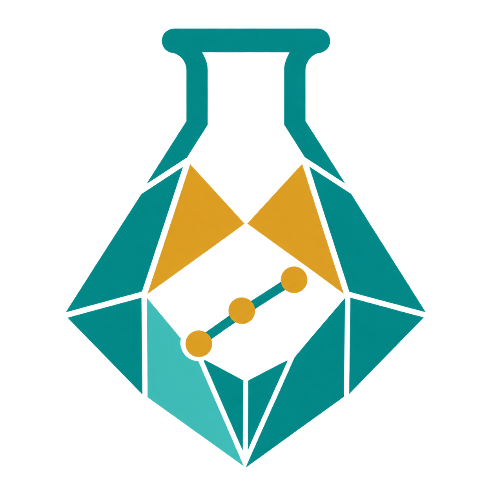

<p align="center">
  
</p>

<h1 align="center">MineralExp · GeoTask19</h1>

<p align="center"><strong>A benchmark for geochemical experimental planning</strong></p>

English | [简体中文](README.zh-CN.md)

A retrospective benchmark for **scientific-task coverage in geoscience experimental planning**, with **277 cases, 19 fine-grained labels, and 1,572 scored experimental operations (O)**. Inputs and references are stored together in JSONL; the runner sends only an allowlisted input projection to the evaluated agent.

This is a locally prepared GitHub submission candidate, **not an uploaded release**. **No open-source license is granted.** On 2026-10-27 the maintainer confirmed that geoscience experts reviewed the dataset without objections; its references are now treated as **expert-reviewed gold**. The confirmation is documented in `data/expert_review_status.json`, without invented identities or agreement statistics. Historical extraction-stage metadata is preserved and does not mean review is still pending.

## Task and scope

Each case provides a source-supported hypothesis, initial information, and available conditions. The agent proposes an experimental plan and returns relevant GeoTask labels. Targets are the union of the 19 categories supported by the released in-scope operations, not a taxonomy of 19 instruments or techniques.

| Process | Labels | Cases with gold labels in this process |
| --- | --- | ---: |
| Source | S1–S4 | 160 |
| Transport | T1–T5 | 170 |
| Deposition | D1–D4 | 146 |
| Modification | M1–M3 | 143 |
| Preservation | P1–P3 | 46 |

Processes overlap within cases. S4 currently has no positive examples.

Following user-reported expert feedback and the final correction, only the actual zircon U–Pb operation `O05` in R15 case `G19-0161` was admitted under **M1, not S1**. M1 retains its original title, with a common definition explicitly accepting host-strata depositional-age constraints. Depositional age is not asserted to be mineralization age. Petrography, CL imaging, and Lu–Hf provenance operations are not automatically chronology labels. The other 22 complete-input scope candidates and 54 input-incomplete cases are excluded.

The original 276 input texts and label sets are unchanged. Of 1,928 operations in the selected local source records, 356 unclassified/supporting operations are omitted from the distributed answers. The complete 353-paper archive remains local and is not distributed.

## Files

| File | Contents |
| --- | --- |
| `data/benchmark.jsonl` | Canonical 277-case dataset: inputs, source metadata, labels, and scored O |
| `data/taxonomy.json` | Fixed 19 labels and common M1 definition |
| `data/expert_scope_decision.json` | Reported feedback, final mapping, and scope exclusions |
| `data/expert_review_status.json` | Current expert-reviewed-gold status, based on maintainer confirmation; supersedes historical pending-review flags |
| `data/exclusions.json` | Index of 76 exclusions, without their full inputs or operations |
| `data/summary.json` | Counts, class support, and version boundaries |
| `data/verification.json` | Data/software check receipt, not model results |
| `geotask19/runner.py` | Scriptable harness interface and input allowlist |
| `geotask19/metrics.py` | Dependency-free strict multilabel scorer |
| `MANIFEST.sha256` | File checksums |
| `examples/model_runs/gpt61_sol_G19_0002_20261027/` | One actual independent gpt-6.1-sol sample: input, original model output, normalized prediction, reproducible scores and provenance |

## Quick start

Python 3.10+. Tests and offline scoring require neither API keys nor third-party packages. Run from this directory:

```bash
python -m unittest discover -s tests -v
python -m geotask19.validate --root .
python -m geotask19.runner --command-json '["python","my_harness.py"]' --harness-id my-harness --model-id model-version --output results/predictions.jsonl
# Optional: independently replay scoring from saved predictions (no model calls).
python -m geotask19.metrics --data data/benchmark.jsonl --predictions results/predictions.jsonl --output results/metrics.json
```

Your adapter receives one UTF-8 JSON request on stdin. Protocol **`geotask19.harness.v2`** supplies the three inputs, all 19 classes, shared instructions, and a JSON Schema. Return one JSON object with:

- `labels`: selected class IDs, the only scoring target.
- `class_predictions`: exactly 19 entries, each containing `class_id`, boolean `selected`, `rationale`, and `experiments`.
- For every selected class: at least one experiment with `name`, `design`, `why_needed`, `expected_evidence`, `supports_hypothesis_if`, `weakens_hypothesis_if`, and `limitations`.
- For unselected classes: an exclusion rationale and `experiments: []`. An overall `plan` string remains optional.

Labels must agree with the 19 decisions. All required text must be nonempty, but its scientific quality is **not graded**. Prospective evidence and interpretation criteria must not be presented as fabricated measurements. The [harness contract](docs/HARNESS.md) gives the complete schema and field definitions; labels-only adapters must upgrade.

The runner now **automatically scores and exports a complete result directory** at `results/predictions.jsonl.artifacts/` (override with `--artifacts-dir`). Existing prediction, exchange and run-metadata sidecars remain supported. The directory contains:

- `requests.jsonl`, `taxonomy.json`, `run.json`, `events.jsonl`, `cases.jsonl`: exact public inputs, shared taxonomy, configuration/coverage, runner lifecycle and sample index.
- `samples/000001/` etc.: request, original stdout text and exact bytes, parsed response, normalized prediction, status, and adapter-returned trajectory/token usage/provider response when supplied.
- `scores/`: `metrics.json`, `overall.csv`, `per_process.csv`, `per_class.csv`, `per_sample.csv`, `errors.jsonl`, gold-label and prediction snapshots for offline replay, and scoring provenance.
- `manifest.json`: file sizes and SHA-256 checksums.

To retain multi-turn messages and tool calls/results, the **adapter** can return an outer `{ "response": <the final v2 response>, "trajectory": [<returned events>], "usage": {<reported usage>}, "provider_response": <optional sanitized provider body> }` envelope. The final model-response schema and all classification formulas stay unchanged. Traces are saved as returned; the runner cannot recover unreturned internal state or hidden reasoning. `provided_by_adapter: false` explicitly marks unavailable traces/usage. Adapters must remove secrets from returned content; stderr, environment variables and authentication headers are not automatically collected. Keep runtime artifacts private until reviewed.

Outputs are flushed per case and run metadata is checkpointed. Fail-fast remains the default; `--continue-on-error` attempts the remaining cases and still exits nonzero on any failure. Failed/interrupted runs retain available responses and write **`scores_partial/`**, never `scores/`: missing predictions are explicitly scored as empty against the full scheduled split, with missing IDs and incomplete coverage recorded. Do not report these as complete runs. Abrupt OS termination or disk failure can leave an unfinished checkpoint rather than a final score. Existing output paths are never silently overwritten.

The standalone scorer also exports `results/metrics.json.artifacts/` by default, including score tables, error analysis and replay inputs; it writes a failure receipt if strict validation fails. It does not regenerate model/tool trajectories. No LLM judge is called, and offline scoring still accepts historical labels-only predictions.

For PowerShell native-command quoting differences, use Python's `call_command()` API. `examples/empty_harness.py` and `examples/structured_harness.py` are protocol fixtures, not model baselines or scientific recommendations.

## Evaluation

A [stored real model example](examples/model_runs/gpt61_sol_G19_0002_20261027/README.md) demonstrates the complete v2 output on one preselected case. It was generated once by a fresh-context native `gpt-6.1-sol` subagent, not by the placeholder adapters or OpenRouter. Gold labels were not supplied to the solver; the parent scored the saved output afterward. It is an illustrative **one-case run, not a full-benchmark score or leaderboard**. The example records the lack of OS-level isolation and cannot rule out pretraining familiarity. Tests recompute its scores without generating a new answer.

One scoring command produces all requested views:

| JSON key | Scope | Scores |
| --- | --- | --- |
| `overall` | All 19 labels | `acc`, `precision`, `recall`, `micro_f1`, `macro_f1` |
| `per_process` | Each of Source, Transport, Deposition, Modification, Preservation | Same five scores |
| `process_average` | Unweighted average across the five processes | Same five scores; not the overall score |

`acc` is **exact-set/subset accuracy**. Precision and recall are micro-averaged; Macro-F1 averages label-wise F1 over the fixed label group. Every process uses all 277 rows, projecting only label columns: false positives on process-negative cases still count. Empty/empty sets match for accuracy; undefined precision, recall, and F1 are zero. Each group also includes support, positive-case counts, TP/FP/FN/TN, and Hamming metrics. Scores are proportions in [0, 1].

Fixed-label Macro-F1 includes unsupported S4, so even a perfect oracle scores 18/19 on overall Macro-F1. The separately reported `macro_supported_classes_only` excludes labels without positives. Legacy per-class, per-sample, micro/macro, and Jaccard fields remain available. See [evaluation definitions](docs/EVALUATION.md).

Predicting four correct labels out of ten reference labels yields 40% recall, 100% precision, and 0 exact-set accuracy—not “40% accuracy.” Multiple O operations with the same class do not duplicate its weight. Missing predictions, unknown/duplicate labels, duplicate tasks, and extra IDs are errors by default. Only explicit `--missing empty` scores missing responses as empty sets and lists their IDs.

Scores measure agreement with expert-reviewed reference task categories, not experimental necessity, scientific validity, budget, sampling coordinates, step ordering, or human–agent collaboration. Valid alternatives may be absent from a source paper. Expert approval of reference annotations does not establish a unique or necessary-and-sufficient experimental plan.
