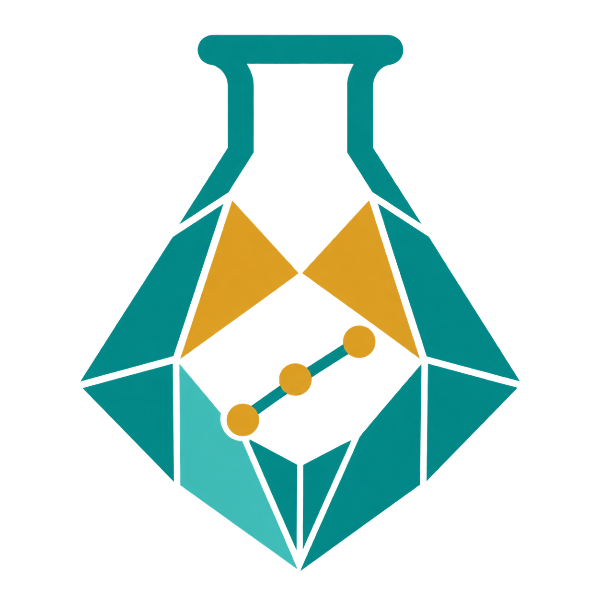

<p align="center">
  
</p>

<h1 align="center">MineralExp · GeoTask19</h1>

<p align="center"><strong>地球化学实验规划评测基准</strong></p>

[English](README.md) | 简体中文

用于评测地学实验规划中**科学任务类别覆盖**的回溯型benchmark，包含 **277条案例、19个细分类、1,572项参与评分的实验操作O**。输入与参考标签同存JSONL；运行器通过白名单提取模型输入，不直接传送参考答案。

这是本地整理的GitHub提交候选包，尚未上传。**暂不授予开源许可。** 维护方于2026-10-27确认数据集已获地学专家审核、无异议，当前作为**专家审核金标**使用，见`data/expert_review_status.json`。不编造审核人身份或一致性统计；规范数据保留的初始提取状态不代表现在仍待审核。

## 任务与范围

每条任务提供原文支持的假说、初始信息和可用条件，要求Agent提出实验规划并输出相关GeoTask类别。标签是论文中参与本版本评分的实验O所支持的19类并集，不是19种仪器或技术。

| 过程 | 类别 | 有该过程参考标签的案例数 |
| --- | --- | ---: |
| 源 Source | S1–S4 | 160 |
| 运 Transport | T1–T5 | 170 |
| 储／沉淀富集 Deposition | D1–D4 | 146 |
| 变 Modification | M1–M3 | 143 |
| 保 Preservation | P1–P3 | 46 |

一条案例可涉及多个过程，以上计数相互重叠。S4目前没有正例。

根据维护方转述的专家意见及最终更正，仅将R15对应案例`G19-0161`的实际锆石U–Pb测年`O05`纳入**M1，而非S1**。M1保留原名称，但通用定义明确接受赋矿地层沉积年龄约束；不宣称沉积年龄就是成矿年龄，也不将同例岩相、CL或Lu–Hf操作一并归入测年。其他22条完整输入扩类候选不纳入，54条缺少原文支持输入的案例也不纳入。

原276条案例的三项输入和类别集合未改。选中案例原有1,928项O中，356项未归类或支持性操作不作为本包答案发布；完整353篇档案保留在维护方本地，未随包分发。

## 文件

| 文件 | 内容 |
| --- | --- |
| `data/benchmark.jsonl` | 唯一规范评测集：277条输入、来源、参考类别及评分O |
| `data/taxonomy.json` | 固定19类及共同的M1定义 |
| `data/expert_scope_decision.json` | 专家反馈转述、最终映射及排除决定 |
| `data/expert_review_status.json` | 维护方确认的最新专家审核金标状态，优先于历史待审字段 |
| `data/exclusions.json` | 76条排除索引；不分发被排除案例的完整输入或O |
| `data/summary.json` | 数据规模、逐类正例支持数及版本边界 |
| `data/verification.json` | 软件与数据检查回执，不是模型成绩 |
| `geotask19/runner.py` | 脚本化Harness接口及输入白名单 |
| `geotask19/metrics.py` | 无第三方依赖的严格多标签评分器 |
| `MANIFEST.sha256` | 文件校验指纹 |
| `examples/model_runs/gpt61_sol_G19_0002_20261027/` | 独立gpt-6.1-sol真实单样本输出：输入、原始模型回答、规范预测、可复算分数及来源记录 |

## 快速运行

Python 3.10+。软件测试和离线评分不需要API密钥或第三方包。在本README所在目录执行：

```bash
python -m unittest discover -s tests -v
python -m geotask19.validate --root .
python -m geotask19.runner --command-json '["python","my_harness.py"]' --harness-id my-harness --model-id model-version --output results/predictions.jsonl
# 可选：用保存的预测独立复算，不调用模型。
python -m geotask19.metrics --data data/benchmark.jsonl --predictions results/predictions.jsonl --output results/metrics.json
```

适配器通过stdin接收单条UTF-8 JSON请求。**`geotask19.harness.v2`**提供三项输入、完整19类、统一指令及JSON Schema。stdout必须返回单个JSON对象：

- `labels`：选中的类别ID列表，唯一评分目标。
- `class_predictions`：恰好19项，每项包含`class_id`、布尔值`selected`、选择／排除理由`rationale`和`experiments`。
- 选中类至少设计1项实验，包含`name`、`design`、`why_needed`、`expected_evidence`、`supports_hypothesis_if`、`weakens_hypothesis_if`、`limitations`七个非空文本字段。
- 未选中类说明排除理由，`experiments`为`[]`；可选`plan`补充整体顺序与共享实验。

`labels`必须与19项决策一致。结构与非空校验**不是科学质量评分**；预期证据必须写成待获取的观测，不能虚构已测结果。[Harness接口](docs/HARNESS.md)提供完整定义，旧的labels-only适配器需要升级。

运行器现在会**自动评分并生成完整结果目录**`results/predictions.jsonl.artifacts/`，可用`--artifacts-dir`指定其他新目录。原有预测、exchange和运行元数据三个文件仍然保留。结果目录包含：

- `requests.jsonl`、`taxonomy.json`、`run.json`、`events.jsonl`、`cases.jsonl`：实际白名单输入、通用分类体系、配置与覆盖率、运行器生命周期及样本索引。
- `samples/000001/`等：逐样本请求、原始stdout文本和精确字节、解析结果、结构化预测、状态，以及适配器实际返回的轨迹、用量和供应商响应。
- `scores/`：`metrics.json`、整体／五过程／逐类／逐样本CSV、`errors.jsonl`、可复算的金标及预测快照、评分来源记录。
- `manifest.json`：文件大小及SHA-256校验值。

需要保存多轮消息、工具调用及工具结果时，**适配器**可在stdout返回外层封装：`{"response": 最终v2响应, "trajectory": [实际返回的事件], "usage": {实际报告的用量}, "provider_response": 可选的已脱敏供应商响应}`。最终模型响应Schema和分类公式不变。轨迹按返回内容保存，不补造内部状态或隐藏思维；`provided_by_adapter: false`明确表示未提供轨迹／用量。适配器须先移除返回内容中的密钥；脚本不自动采集stderr、环境变量和HTTP鉴权头。运行产物未经检查不要公开。

每个样本完成后立即刷新输出和运行状态。默认仍遇错停止；加`--continue-on-error`可继续剩余案例，但出现失败仍返回非零退出码。失败／中断保留可用响应，另存**`scores_partial/`**，不生成正式`scores/`：明确按全计划样本数、`missing=empty`计算部分运行诊断，记录漏答ID及覆盖率，不能冒充完成的全量结果。强制终止进程或磁盘故障可能只留下未完成的检查点。已有输出路径不会静默覆盖。

独立评分命令默认也生成`results/metrics.json.artifacts/`，保存指标表、错例与复算输入；严格校验失败时保存错误回执。评分器不会重新生成模型／工具轨迹。**当前不调用Judge，文字不进入分类分数**；离线评分仍兼容历史labels-only预测。

PowerShell遇到原生命令JSON转义差异时，可使用Python的`call_command()`。`examples/empty_harness.py`和`examples/structured_harness.py`只检查协议，不是模型基线或科学建议。

## 评分

[真实模型样例](examples/model_runs/gpt61_sol_G19_0002_20261027/README.md)展示了完整v2输出。一次独立上下文的原生`gpt-6.1-sol`子智能体对预先固定的单条案例推理；求解者不接收金标，主进程在输出保存后离线评分。不是接口占位回答，也不是OpenRouter推理；**只有单样本，不能当作全库成绩或排行榜**。记录明确不具备OS级隔离，也不能排除预训练记忆。软件测试只复算已保存结果，不重新生成模型答案。

一次评分同时返回三组结果：

| JSON位置 | 范围 | 指标 |
| --- | --- | --- |
| `overall` | 全部19类 | `acc`、`precision`、`recall`、`micro_f1`、`macro_f1` |
| `per_process` | 源、运、储、变、保各组 | 同上五项 |
| `process_average` | 五组分数等权平均 | 同上五项；不是整体分数 |

`acc`是类别集合**完全匹配率**，precision/recall是micro平均，MacroF1按固定细分类逐类计算再平均。五组都使用全部277条案例，只投影类别列，既计漏报也计无关过程的误报；空集对空集的acc为1，precision/recall/F1除零为0。各组附正例案例数、类别支持数、TP/FP/FN/TN及Hamming指标。所有得分为0–1比例。

固定19类MacroF1包含零正例S4，因此即使所有预测都完全正确也为18/19；报告另附`macro_supported_classes_only`供区分。原有逐类、逐样本、micro/macro及Jaccard结果保留。[评分协议](docs/EVALUATION.md)列出完整定义。

若参考有10类，只预测其中4类且全对，召回率为40%、精确率为100%、完全匹配准确率为0，不能笼统称准确率40%。同类多个O不重复计权。默认漏答、未知类、重复类、重复样本及额外ID报错；只有显式`--missing empty`才将漏答计为空预测并列出ID。

本包测量对专家审核参考类别的覆盖一致性，不直接评价实验必要性、技术合理性、成本、采样坐标、实验顺序或人机协作质量。合理替代实验可能未被论文覆盖；专家批准参考标注不等于原论文方案就是唯一或必要且充分的方案。
